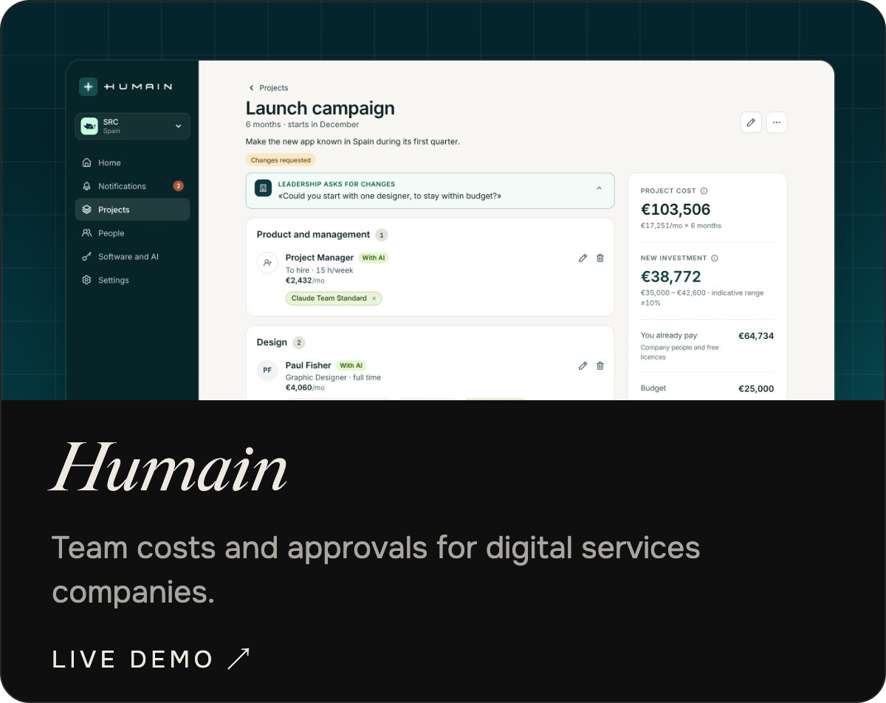
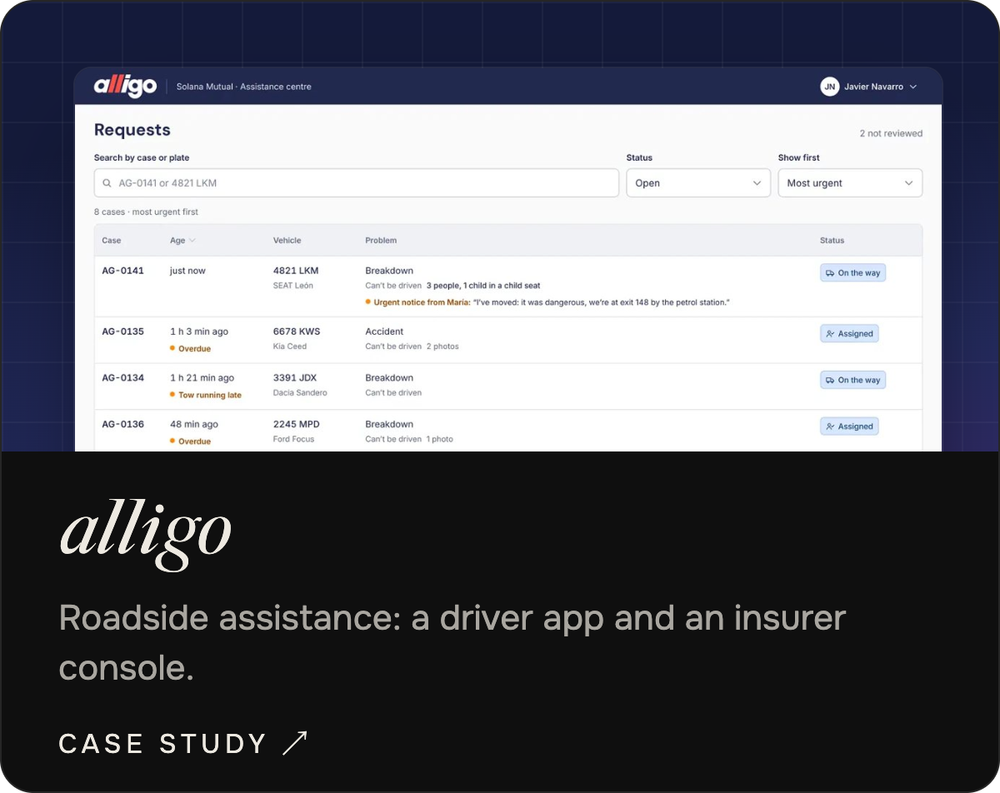
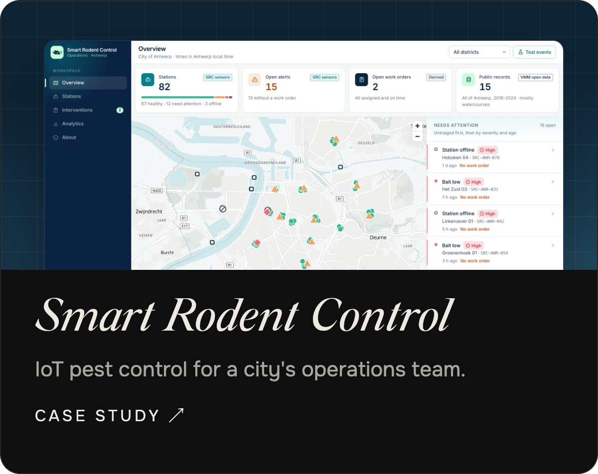
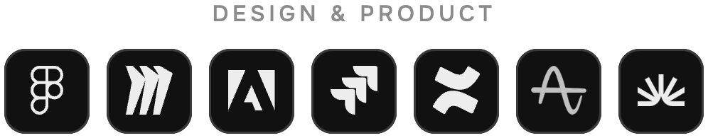
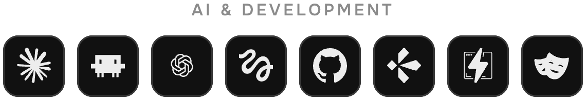

  

<h3 align="center">Hi, I'm María.</h3>

  Lead Product Designer &amp; Product Builder with 10+ years of design experience across complex B2B and B2C products. 
  I combine product strategy, design leadership and hands-on execution, bringing ideas to life through AI-assisted development.

  
  
  
  

 

<h3 align="center">AI Lab</h3>

Independent product explorations, from problem framing and design to functional implementation with AI.

  
  
  

 

<h3 align="center">Tools</h3>

  
    
  

 

<h3 align="center">What's next</h3>

  

  Currently exploring AI-assisted product development, design engineering and new workflows that connect product strategy, design and implementation.

  

